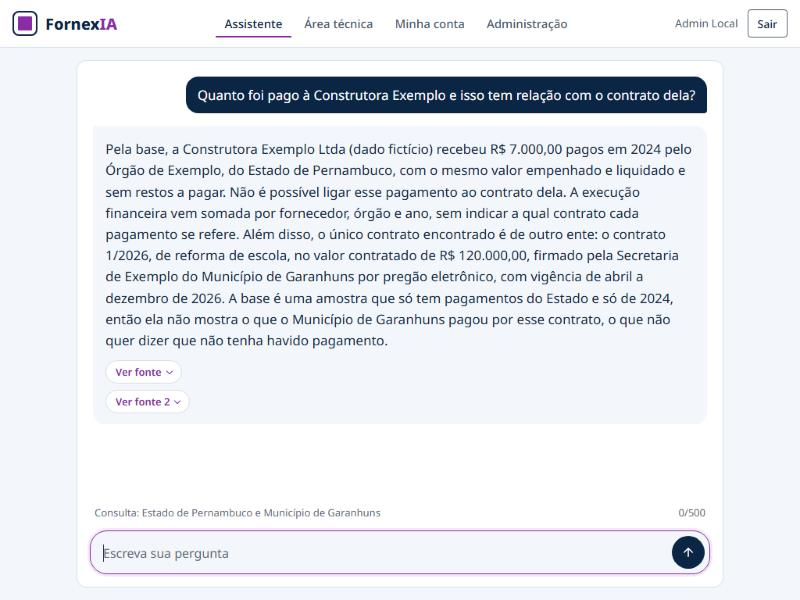
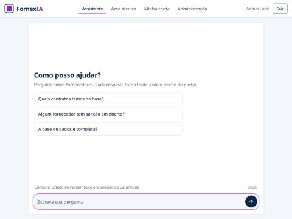
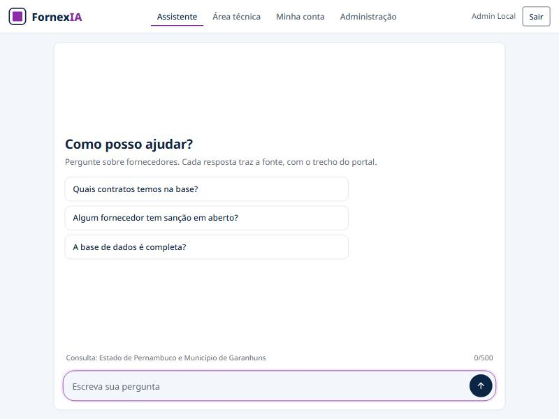

# PRONTO × PLANEJADO: o que o FornexIA faz hoje

**Para:** time de marketing e comercial. **Data:** 12/11/2026. **Autor:** Isaac (tarefa da planilha: "Lista do que está pronto contra o que é só planejado").
**Versão do código:** branch `dev-isaac`, em cima de `feat/portabilidade-windows-linux` no commit `a93dca9` (12/11).

**Regra usada:** só está em PRONTO o que tem evidência. Sem evidência, vai para PLANEJADO ou para "não verificado". O folheto e o pitch só devem
prometer o que está na coluna PRONTO.

Cada item pronto cita a evidência entre colchetes, e a etiqueta diz que tipo de prova é:

| Etiqueta | O que significa |
|---|---|
| **rodei 12/11** | Executei hoje, na minha máquina (Windows 11) |
| **rodei 08/11** | Executei em 08/11 na minha máquina, com o modelo real e dados fictícios, numa versão anterior desta mesma branch |
| **time 12/11** | O Rodrigo registrou que verificou, no diário `docs/sessoes/2026-11-12-rodrigo.md`. Eu não repeti |
| **código** | Li o trecho no código, mas não executei |

## A tabela

| PRONTO (pode dizer) | PLANEJADO (não prometer ainda) |
|---|---|
| **Consulta de fornecedor por nome ou CNPJ.** Perguntar em português, pelo nome ou pelo CNPJ completo, e receber contratos, sanções e pagamentos, cada um com a fonte [E9, rodei 12/11; pagamentos em E1, rodei 08/11] | Tela com o campo "Consultar fornecedor (CNPJ)", como no desenho do folheto. Hoje a consulta é só pelo chat |
| **Fontes de dados.** Coleta de Garanhuns (contratos e licitações) e do Estado de PE (contratos de 2024, cadastro de sanções de 05/06/2025 e execução financeira) [E2, código] | Sanções federais (CEIS, CNEP). Contratos do Estado de 2025 em diante. Pagamento ligado a um contrato. Outros estados e municípios |
| **Fonte em cada resposta.** Trecho literal, data da captura, link e conferência do hash do arquivo guardado [E1, rodei 08/11] | Selo de tempo assinado por terceiro ("isso existia nesta data") |
| **Controle de perfil.** O perfil decide quais entes a pessoa consulta, e o modelo não consegue mudar isso [E3, rodei 12/11] | Planos diferentes por região. Hoje existe um plano único, que vê Estado de PE e Garanhuns juntos |
| **Aprovação de WhatsApp pelo administrador.** A conta cadastra até 3 números e o administrador aprova ou bloqueia [E4, rodei 12/11] | Perfil que enxerga dado de pessoa física. Não é oferecido |
| **Histórico do fornecedor.** A resposta junta contratos, sanções e pagamentos do mesmo fornecedor [E1, rodei 08/11] | Tela com o histórico de consultas do usuário. Ao recarregar a página, a conversa some da tela |
| **Memória da conversa.** O assistente lembra das 3 últimas perguntas e entende "esse fornecedor" [E5, rodei 08/11] | Memória mais longa, ou que sobreviva ao reinício do sistema |
| **Registro de consultas.** Cada consulta grava perfil, entes, ferramenta usada e evidências. CPF digitado é mascarado [E6, rodei 12/11] | Tela para o cliente ou o administrador ver a trilha de uso. Hoje os registros são arquivos no notebook |
| **Monitoramento interno.** Logs por peça do sistema, reconstrução de uma pergunta de ponta a ponta e vigia que registra quedas [E7, rodei 12/11] | Aviso automático (e-mail ou WhatsApp) quando uma peça cai |
| **Relatório: pacote de prova.** Botão "Exportar prova" baixa um ZIP com pergunta, resposta, trechos e hashes, que um auditor confere sem acesso ao sistema [E8, rodei 12/11] | Relatório em PDF. Painel gerencial. Alertas "avise-me quando o fornecedor mudar" |
| **Fila de atendimento.** Perguntas entram em fila, com a posição mostrada na tela, e 3 agentes atendem o site [E4, rodei 12/11] | Cache próprio. Hoje só existe o cache do provedor do modelo |
| **Site com contas.** Cadastro, login, chat, página da conta e administração, no ambiente local [E4, rodei 12/11] | Cobrança real, franquia de consultas e preço por excedente. Integração com ERP. API para clientes |

## Não verificado (não tratar como pronto)

| Item | Por que não está em PRONTO |
|---|---|
| **Busca por CNPJ na base real** | Provada só com os dados fictícios [E9]. Pelo código, fornecedor cujo documento vem mascarado no portal fica sem CNPJ e só é achado pelo nome. Não sei quantos fornecedores da base real estão nessa situação. CNPJ parcial não devolve nada |
| **Tamanho da base real** (100 contratos: 70 do Estado, 30 de Garanhuns) | A base real não está na minha máquina (dados brutos não vão para o Git). O número vem do README e da página inicial do site. É a tarefa da Gabi de 15/11 |
| **WhatsApp com número real** | time 12/11: respondeu a mensagens reais de texto. Eu não testei. Áudio não foi verificado por ninguém |
| **Site publicado** (domínio e HTTPS) | É a tarefa da Gabi de 12/11. O código novo (pacote de prova, registros) ainda não foi publicado na hospedagem, segundo o diário do Rodrigo |
| **Resistência a ataques de prompt** | 0 de 20 ataques executados com o modelo real. A camada de dados está testada. É a minha tarefa de 13/11 |
| **Conferência do pacote por um terceiro** | Vi o ZIP e os arquivos dentro dele, e os 33 testes do time passaram. Não rodei à mão o `verificar_prova.py` que vai no pacote, como um auditor faria |

## Folheto × sistema: o que corrigir

| O folheto diz | O que o sistema faz hoje | Sugestão |
|---|---|---|
| "756 contratos analisados", "240 licitações" | São linhas **capturadas** do portal de Garanhuns. No assistente, dá para consultar 30 contratos de Garanhuns e 70 do Estado (amostra) | Dizer "756 contratos capturados; amostra de 100 consultável na demonstração" |
| "Franquia de consultas e cobrança por uso excedente" | Plano único de demonstração, R$ 149 por mês, franquia 0, sem excedente e sem nenhum código de cobrança [E10] | Alinhar com o site: "plano único, valor de demonstração" |
| "Acesso por região" | O mecanismo existe e está testado, mas o único plano oferecido vê tudo | Dizer "controle de acesso por ente, pronto para planos regionais" |
| "Conformidade com LGPD" | Há medidas: pessoa física fora das respostas e CPF mascarado nos registros. Ninguém avaliou a conformidade, e o pacote de prova marca `dados_pessoais: null` | Trocar por "medidas de proteção de dados pessoais" |
| "Com filas, cache e monitoramento" | Fila e monitoramento existem. Cache próprio não existe | Tirar "cache" |
| Tela "Consultar fornecedor (CNPJ)" | Não existe. A consulta é por conversa | Mostrar a tela real do chat |
| "Reduz o tempo de investigação" | Hipótese, ainda sem validação (o próprio site diz isso) | Dizer "hipótese em validação" |
| "Controle de acesso por perfil, com trilhas de uso" | Verdadeiro, mas a trilha é um arquivo interno, sem tela | Não mostrar "trilha" como tela do produto |

## Evidências

**E1. Conversa real com fonte, histórico do fornecedor e pagamento separado do contrato.** 08/11/2026, site local, modelo real, dados fictícios.
Sete perguntas respondidas em 15 a 21 s: 4 direto no agente e 3 pelo site, estas com o botão "Ver fonte". Relato completo: documento "Conversa completa com o modelo real: falhas (08/11/2026)".
Código: `consulta/mcp_transparencia.py`, linhas 297 a 364 (`contratos_do_fornecedor`, `sancoes_do_fornecedor`, `execucao_do_fornecedor`, `conferir_evidencia`).

**E2. Fontes de dados.** `coleta/estado.py` (painéis do Estado de PE: contratos e execução), `coleta/extrair.py` (transforma a captura em fatos com evidência),
`coleta/amostra.py` (separa 100 contratos: 70 do Estado e 30 de Garanhuns), `coleta/carregar_neo4j.py`. Não há nenhum extrator federal: a busca por
"CEIS", "CNEP" e "Portal da Transparência" no código não devolve nada.

**E3. Controle de perfil.** Os entes entram pelo ambiente do servidor de consultas, nunca por argumento: `consulta/mcp_transparencia.py`, linhas 40 e 193 a 197
(toda consulta ao banco recebe `tenants=TENANTS`). Sem perfil exato, a pergunta é recusada: `chat/agente.py`, linhas 97 a 102. Perfis em `consulta/perfis.json`.
rodei 12/11: `python -m unittest discover -s consulta/testes` → **65 testes OK, nenhum pulado** (Neo4j no ar, dados fictícios).
Ao vivo em 12/11, a mesma pergunta ("O CNPJ 11.111.111/0001-11 tem sanções?") com dois perfis: o perfil Estado mostrou a multa do cadastro do Estado; o perfil
Município (`python chat/agente.py municipio "..."`) respondeu que não encontrou sanções e que "entes fora desse perfil não foram consultados". A tela mostra o perfil em uso:

**E4. Site, fila e administração.** rodei 12/11: `python site/dev/test_api.py` → **82 testes OK** (PHP e MariaDB reais, worker simulado), e uso ao vivo do
`chat.html` com login. Rotas em `site/public_html/api/index.php`, linhas 45 a 65.

**E5. Memória da conversa.** `chat/worker.py`, linha 51: `deque(maxlen=3)`, guardado em memória do processo. Ao vivo em 08/11: "E esse fornecedor…" foi entendido
como a Construtora Exemplo (primeiro print de E1). Ao recarregar a página, o site só busca a pergunta em andamento: `site/public_html/assets/api.js`, linha 50.
Conferido ao vivo em 12/11: depois de recarregar, a conversa anterior não aparece mais.

**E6. Registro de consultas.** `consulta/mcp_transparencia.py`, linhas 154 a 166 (uma linha por consulta em `logs/consultas.jsonl`) e linhas 74 a 81 (máscara de CPF).
Ao vivo em 12/11: a pergunta `site:1100` deixou em `logs/consultas.jsonl` uma linha por consulta, com `perfil: estado`, os dois entes, a ferramenta e as evidências
(`e1`, `g1`). `python scripts/jornada.py site:1100` mostrou a pergunta inteira: 6 consultas, modelo `claude-sonnet-5-5`, 28 s, 2 fontes.

**E7. Monitoramento interno.** rodei 12/11: `python -m unittest discover -s chat/testes` → **205 testes OK, 13 pulados** (Windows 11; inclui `test_registro`,
`test_observabilidade`, `test_vigia` e `test_jornada`). Código: `consulta/registro.py`, `chat/vigia.py`, `scripts/jornada.py`. Nenhuma página do site mostra esses
registros: a busca por "log", "trilha" e "auditoria" em `admin.html` e `conta.html` não devolve nada.

**E8. Pacote de prova.** `site/public_html/api/lib_prova.php`, linhas 356 a 361 (`rota_prova`, `rota_provas`); rotas em `site/public_html/api/index.php`, linhas 60 e 61;
botão em `site/public_html/assets/chat.js` (`adicionarExportar`). rodei 12/11: `python site/dev/test_prova.py` → **33 testes OK**. Ao vivo em 12/11, o botão
da pergunta `site:1100` devolveu `prova-fornexia-consulta-1100.zip` (11,5 KB) com `prova.json`, `LEIA-ME.txt`, `verificar_prova.py` e 2 arquivos em `trechos/`.
Limites declarados pelo time: o arquivo bruto do portal não vai no pacote e o hash do trecho é
calculado na exportação.

**E9. Busca por CNPJ.** `consulta/mcp_transparencia.py`, linhas 242 a 255: busca por parte do nome **ou** pelo CNPJ exato (só os dígitos).
`coleta/extrair.py`, linhas 172 a 179: fornecedor com documento mascarado e não resolvido fica sem CNPJ (`"cnpj": None`) e só é achado pelo nome.
rodei 12/11, direto na ferramenta, com o perfil Estado e dados fictícios: `11.111.111/0001-11` e `11111111000111` acham a Construtora Exemplo; `11111111` (parcial)
não acha nada; `33.333.333/0001-33` (fornecedor de um ente fora do perfil) não acha nada. Ao vivo no site, a pergunta "O CNPJ 11.111.111/0001-11 tem contratos ou
sanções?" foi respondida com o contrato, a sanção, duas fontes e o botão "Exportar prova":

**E10. Plano e cobrança.** `site/setup.php`, linha 108: `['Único', 149.00, 0, 0.00, ['pe-estado', 'pe-garanhuns']]`. Seletor de plano desligado:
`site/public_html/assets/chat.js`, linha 26 (`ESCOLHER_PLANO = false`). Os campos de franquia e excedente só são devolvidos pela API, nenhuma rota os usa.

## Limites desta verificação

Tudo que rodei foi no **ambiente local**, com **dados fictícios** (`fixtures/exemplo`) e uma conta de teste que só existe na minha máquina.
Não tenho a base real nem acesso ao site publicado, então nada aqui prova o comportamento com dados reais ou em produção.
Os prints de 08/11 são de uma versão anterior desta mesma branch.
